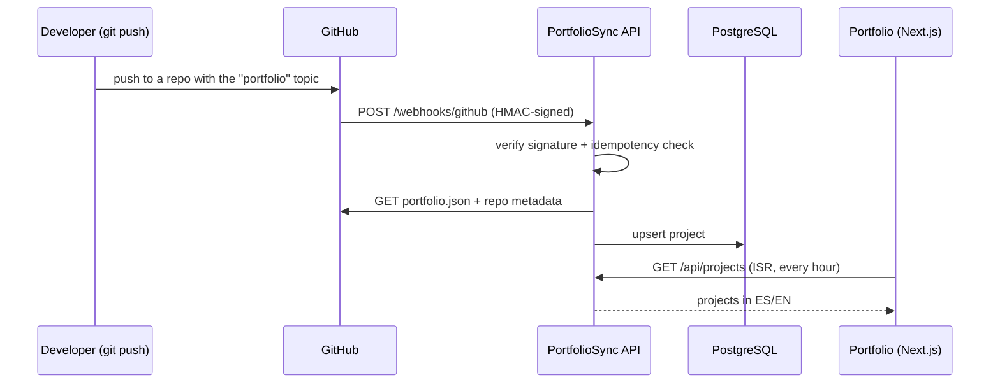
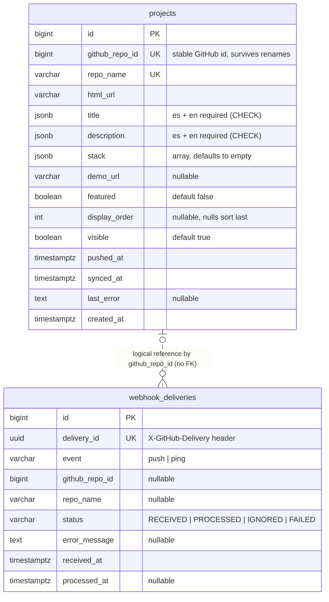

# PortfolioSync API

[](https://github.com/AlmeidaSNicolas/portfoliosync-api/actions/workflows/ci.yml)

Backend that keeps the projects section of my portfolio up to date on its own. When I push to a GitHub repository that has the `portfolio` topic and a `portfolio.json` file, a webhook tells this API, the API reads the repository's metadata and stores the project, and the portfolio site lists it in Spanish or English.

> 🚧 **Work in progress.** Sprints 0 to 2 are done, and Sprint 3 is underway. Two endpoints are live: `GET /api/projects` lists the visible projects in Spanish or English, and `POST /webhooks/github` accepts GitHub deliveries, verifies their HMAC signature and records each delivery once. A tested sync service already turns a repository into a stored project (create or update). Still missing in Sprint 3: hiding projects that lose the topic or the file, storing `last_error`, and calling the sync from the webhook. See the [roadmap](#roadmap).

## How it works



## Repository convention

A repository shows up on the portfolio when it has both:

1. The `portfolio` **topic** on GitHub.
2. A `portfolio.json` file at its root:

```json
{
  "title": { "es": "Bot de curaduría geopolítica", "en": "Geopolitical news curation bot" },
  "description": { "es": "Java puro, sin frameworks…", "en": "Plain Java, no frameworks…" },
  "stack": ["Java", "PostgreSQL", "Docker"],
  "demoUrl": "https://t.me/geopoliticaNews",
  "featured": true,
  "order": 1
}
```

`title` and `description` are required in both languages; the other fields are optional.

## Data model



Key decisions:

- **`github_repo_id` as the upsert key**, not `repo_name`: the name changes when a repository is renamed, the GitHub id never does.
- **`jsonb` for translated text and stack**: these values are always read together with the project, so there is no join, one row carries both languages, and adding a language needs no migration. `CHECK` constraints enforce that both `es` and `en` exist.
- **Hide instead of delete**: a repository that loses the topic gets `visible = false`, so it comes back with its history if the topic returns.
- **Idempotent webhooks**: each delivery is inserted first; the `UNIQUE` constraint on `delivery_id` rejects GitHub retries atomically, then the delivery is processed and its status updated.
- **`webhook_deliveries` has no foreign key**: it is a log, and it also records deliveries for repositories that never became projects.

## API

### `GET /api/projects`

Lists the visible projects, with the translated fields in one language.

| Query parameter | Values | Default |
| --- | --- | --- |
| `lang` | `es`, `en` | `es` |

```bash
curl "http://localhost:8080/api/projects?lang=en"
```

```json
[
  {
    "repoName": "geopolitica-news-bot",
    "title": "Geopolitical news curation bot",
    "description": "Plain Java, no frameworks…",
    "stack": ["Java", "PostgreSQL"],
    "htmlUrl": "https://github.com/AlmeidaSNicolas/geopolitica-news-bot",
    "demoUrl": null,
    "featured": true
  }
]
```

The response is a DTO (`ProjectResponse`), never the JPA entity: internal fields such as `lastError` or `syncedAt` stay inside the API, and the JSON does not change when the table does.

An unsupported language returns `400 Bad Request` as an [RFC 9457](https://www.rfc-editor.org/rfc/rfc9457) problem detail, produced by a global `@RestControllerAdvice`:

```json
{
  "title": "Bad Request",
  "status": 400,
  "detail": "Unsupported language: pt",
  "instance": "/api/projects"
}
```

### `POST /webhooks/github`

Receives GitHub webhook deliveries. It is called by GitHub, not by the site.

| Header | Use |
| --- | --- |
| `X-Hub-Signature-256` | `sha256=` + HMAC SHA-256 of the raw body, signed with the webhook secret |
| `X-GitHub-Event` | event name (`push`, `ping`) |
| `X-GitHub-Delivery` | unique delivery id (UUID), used for idempotency |

| Response | When |
| --- | --- |
| `200 OK` | valid signature; the delivery is recorded (a repeated delivery id is accepted but not recorded again) |
| `401 Unauthorized` | signature missing, malformed or wrong |

How it works:

- **Raw body for the signature**: the controller receives the body as `byte[]`. The HMAC must be computed over the exact bytes GitHub sent; parsing the JSON first and serializing it again could change spacing or key order and break the check.
- **Constant-time comparison**: `HmacValidator` compares signatures with `MessageDigest.isEqual`, so the time taken does not reveal how many characters matched (timing attack).
- **Missing signature is a 401, not a 400**: the header is declared with `required = false`, so a request without it reaches the validator and gets the same answer as a wrong signature.
- **Secret from the environment**: `github.webhook.secret=${GITHUB_WEBHOOK_SECRET}` has no default value, so the app refuses to start without it instead of running with a guessable secret.
- **Idempotency in the database**: `WebhookDeliveryService` inserts the delivery with `saveAndFlush`; GitHub retries reuse the same `X-GitHub-Delivery`, and the `UNIQUE` constraint on `delivery_id` rejects them (`DataIntegrityViolationException` → "already seen"). The database decides atomically, so two retries arriving at the same time cannot both pass.

Interactive docs (springdoc): <http://localhost:8080/swagger-ui.html>

## GitHub client

`GithubClient` has two calls.

**`getPortfolioFile(repoName)`** returns the repository's `portfolio.json` as a `PortfolioFile` record:

1. It calls the [repository contents endpoint](https://docs.github.com/en/rest/repos/contents) with Spring's `RestClient`.
2. It decodes the `content` field of the response, which GitHub sends in Base64.
3. It maps the decoded JSON to `PortfolioFile` with Jackson.

**`getRepoMetadata(repoName)`** calls [`GET /repos/{owner}/{repo}`](https://docs.github.com/en/rest/repos/repos#get-a-repository) and maps the answer straight to a `RepoMetadata` record: `id`, `name`, `htmlUrl`, `topics` and `pushedAt`. `@JsonProperty` maps GitHub's snake_case names (`html_url`, `pushed_at`), and the date becomes an `Instant`. A 404 becomes `RepositoryNotFoundException`.

Key decisions:

- **Contents API instead of `download_url`**: raw file URLs are cached for a few minutes after a push, so a webhook could read a stale file.
- **Own exceptions for a 404**: `PortfolioFileNotFoundException` and `RepositoryNotFoundException` replace Spring's `HttpClientErrorException.NotFound` and keep it as the cause, so the rest of the code never depends on Spring's HTTP exceptions.
- **Validation is a separate step**: the client only fetches. `PortfolioValidator` requires `title` and `description` in both `es` and `en`, stops at the first problem and throws `InvalidPortfolioFileException`. The sync service calls it before saving; storing the error in `last_error` comes next.
- **Base URL in configuration**: it comes from `github.api.base-url`, so tests can point the client at a local server.

`GithubClientTest` uses [WireMock](https://wiremock.org/) to run a real HTTP server on a random port in place of GitHub. It covers a successful read and a 404 for both calls, and needs neither Docker nor internet access.

## Sync

`SyncService.sync(repoName)` turns one repository into a stored project:

1. Reads the repository metadata.
2. Stops if the `portfolio` topic is missing (guard clause: nothing is fetched or saved).
3. Reads `portfolio.json` and validates it.
4. Calls `ProjectService.saveOrUpdate`, which looks the project up by `github_repo_id`: if it exists, it is updated; if not, it is created.

Key decisions:

- **The sync orchestrates, `ProjectService` owns the data**: `SyncService` lives in its own `sync` feature and never touches `ProjectRepository`. Only the project feature reads and writes projects.
- **One update method instead of setters**: `Project.updateFromGithub(...)` changes every field that comes from GitHub and sets `syncedAt` in one call, so no caller can update half a project. `github_repo_id` is not part of it: it is the identity.
- **Update without `save`**: `saveOrUpdate` is `@Transactional`. The project loaded by `findByGithubRepoId` is managed by Hibernate, which detects the changes (dirty checking) and writes the `UPDATE` when the transaction commits. Only a new project needs `save`.
- **Safe defaults for optional fields**: a missing `stack` becomes an empty list (the column is `NOT NULL`), and a missing `featured` becomes `false` with `Boolean.TRUE.equals(...)`, avoiding a `NullPointerException` on unboxing.

`SyncServiceTest` runs against a real PostgreSQL (Testcontainers) with `GithubClient` replaced by a Mockito mock (`@MockitoBean`). It covers a new repository (one project created), the same repository synced twice with a new title (still one project, title updated) and a repository without the topic (nothing saved, `portfolio.json` never requested).

## Project structure

Packages are split by feature first, then by layer inside each feature, so every feature keeps its own boundary and the layers stay visible. A feature talks to another one only through its service.

```
io.github.almeidasnicolas.portfoliosync
├── project/
│   ├── controller/   ProjectController (GET /api/projects)
│   ├── service/      ProjectService (entity → DTO, language selection)
│   ├── repository/   ProjectRepository (Spring Data JPA)
│   ├── dto/          ProjectResponse
│   ├── domain/       Project (entity), LocalizedText (es/en value)
│   └── seed/         ProjectSeeder (sample data, "dev" profile only)
├── github/
│   ├── client/       GithubClient (portfolio.json + repository metadata)
│   ├── service/      PortfolioValidator
│   ├── dto/          PortfolioFile, RepoMetadata, ContentDTO
│   └── exception/    PortfolioFileNotFoundException, RepositoryNotFoundException, InvalidPortfolioFileException
├── webhook/
│   ├── controller/   WebhookController (POST /webhooks/github)
│   ├── service/      HmacValidator, WebhookDeliveryService (idempotency)
│   ├── repository/   WebhookDeliveryRepository
│   └── domain/       WebhookDelivery (entity), DeliveryStatus
├── sync/
│   └── service/      SyncService (GitHub → validation → project upsert)
└── shared/
    └── exception/    GlobalExceptionHandler, UnsupportedLanguageException
```

## Tech stack

Java 21 · Spring Boot 4.1 · Spring Web MVC · Spring Data JPA (Hibernate) · PostgreSQL 17 · Flyway · springdoc-openapi · Actuator · Lombok · JUnit 5 · Testcontainers · WireMock · Docker Compose · Maven · GitHub Actions (CI)

Planned: Bean Validation, Spring Security (admin endpoints), CD with GitHub Actions, deploy to Render + Neon.

## Database migrations

The schema is owned by Flyway. Migrations live in `src/main/resources/db/migration` and run when the app starts; Hibernate runs with `ddl-auto=validate`, so it only checks that the entities match the tables and never changes the schema. A migration that has already been applied is never edited: any change goes in a new `V<n>__` file.

## Continuous integration

[`.github/workflows/ci.yml`](.github/workflows/ci.yml) runs `./mvnw verify` on every push to `main` and every pull request targeting `main`, using Temurin 21 with the Maven dependency cache. The integration tests start PostgreSQL 17 through Testcontainers, so CI needs no database configuration.

## Running locally

Requirements: Java 21 and Docker.

```bash
docker compose up -d                                       # starts PostgreSQL 17 on localhost:5432
GITHUB_WEBHOOK_SECRET=dev-secret-local ./mvnw spring-boot:run  # runs Flyway migrations and starts the API on :8080
```

Health check: <http://localhost:8080/actuator/health>

To start with sample projects, run with the `dev` profile. `ProjectSeeder` inserts three projects when the table is empty and never runs in other environments:

```bash
SPRING_PROFILES_ACTIVE=dev GITHUB_WEBHOOK_SECRET=dev-secret-local ./mvnw spring-boot:run
```

Configuration comes from environment variables, with local defaults (the database ones match `compose.yaml`):

| Variable | Local default |
| --- | --- |
| `DB_URL` | `jdbc:postgresql://localhost:5432/portfoliosync` |
| `DB_USERNAME` | `portfoliosync` |
| `DB_PASSWORD` | `portfoliosync` |
| `GITHUB_API_URL` | `https://api.github.com` |
| `GITHUB_WEBHOOK_SECRET` | none: **required**, the app does not start without it |

Run the tests (Testcontainers starts its own PostgreSQL, so Docker must be running):

```bash
./mvnw verify
```

## Roadmap

- [x] **Sprint 0 — Setup:** project skeleton, Docker Compose, Flyway, README with data model, CI running `./mvnw verify`
- [x] **Sprint 1 — Projects:** entity, `GET /api/projects` with seed data, per-language DTOs, error handling
- [x] **Sprint 2 — GitHub client:** read `portfolio.json`, JSON validation, WireMock tests
- [ ] **Sprint 3 — Webhook and sync** (in progress)
  - [x] HMAC signature check
  - [x] `POST /webhooks/github` (401 on an invalid signature)
  - [x] Idempotency by delivery id
  - [x] Read repository topics and metadata
  - [x] Sync: create or update the project
  - [ ] Hide projects that lose the topic or the file, keep the last valid version, store `last_error`
  - [ ] Run the sync when a `push` delivery arrives
- [ ] **Sprint 4 — Admin and ordering:** token-protected manual resync, listing order
- [ ] **Sprint 5 — Deploy:** Dockerfile, Render + Neon, CD with GitHub Actions
- [ ] **Sprint 6 — Portfolio:** Next.js site consuming the API with ISR and a fallback
